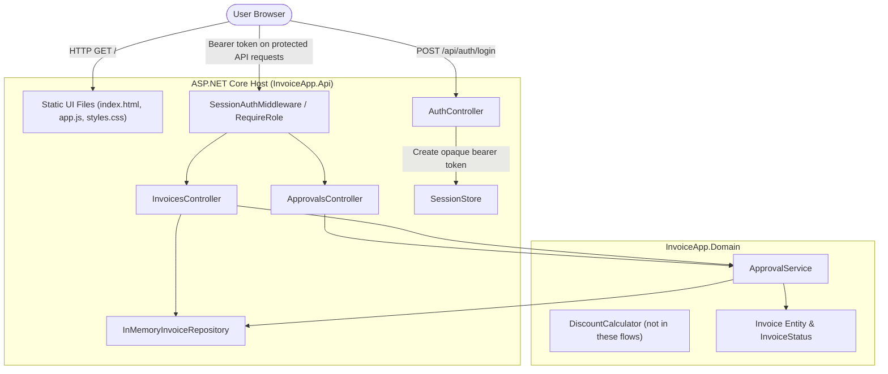
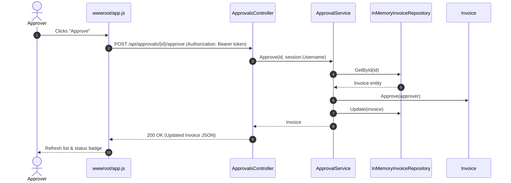

# Architecture Diagrams and System Evolution

## As-Built Container View (C4 Level 2)

### Component Citations
- `Static UI files`: `backend/src/InvoiceApp.Api/wwwroot/index.html`, `app.js`, `styles.css`
- `SessionAuthMiddleware`: `backend/src/InvoiceApp.Api/Auth/SessionAuthMiddleware.cs`
- `SessionStore`: `backend/src/InvoiceApp.Api/Auth/SessionStore.cs`
- `AuthController`: `backend/src/InvoiceApp.Api/Controllers/AuthController.cs`
- `ApprovalsController`: `backend/src/InvoiceApp.Api/Controllers/ApprovalsController.cs`
- `InvoicesController`: `backend/src/InvoiceApp.Api/Controllers/InvoicesController.cs`
- `InMemoryInvoiceRepository`: `backend/src/InvoiceApp.Api/InMemoryInvoiceRepository.cs`
- `ApprovalService`: `backend/src/InvoiceApp.Domain/ApprovalService.cs`
- `DiscountCalculator`: `backend/src/InvoiceApp.Domain/DiscountCalculator.cs`
- `Invoice`: `backend/src/InvoiceApp.Domain/Invoice.cs`

### Inferences Corrected Against the Codebase

| Agent-inferred item | Actual codebase reality |
| --- | --- |
| Assumed database connection via EF Core | Entirely in memory; `InMemoryInvoiceRepository` stores invoices in a lock-protected `List<Invoice>`. |
| Assumed JWT Bearer tokens | Simple custom header `X-Session-Id` mapped in memory |
| Assumed external notification worker | No background workers; requests are handled synchronously. |

---

## As-Built Approval Sequence Diagram

---

## Target State Architecture (Tier-2 Production)

> Items highlighted with dashed borders represent planned components that are not yet present in the codebase.