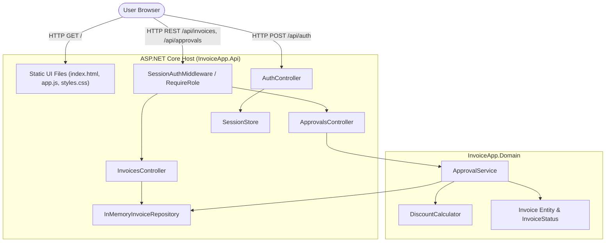
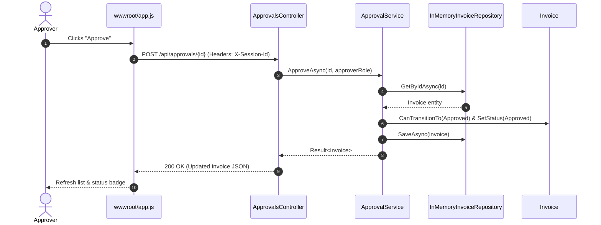
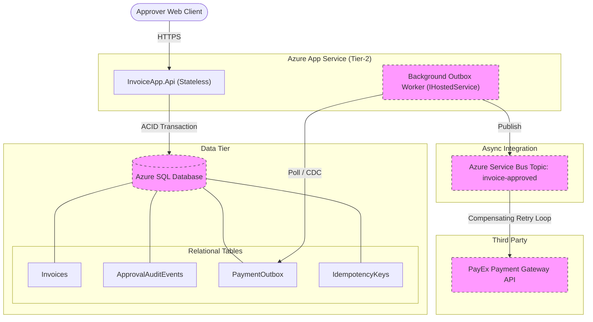

# Architecture Diagrams & System Evolution

## 1. As-Built Container View (C4 Level 2)

### Component Citations
* `Static UI Files`: `backend/src/InvoiceApp.Api/wwwroot/index.html`, `app.js`, `styles.css`
* `SessionAuthMiddleware`: `backend/src/InvoiceApp.Api/Auth/SessionAuthMiddleware.cs`
* `SessionStore`: `backend/src/InvoiceApp.Api/Auth/SessionStore.cs`
* `ApprovalsController`: `backend/src/InvoiceApp.Api/Controllers/ApprovalsController.cs`
* `InvoicesController`: `backend/src/InvoiceApp.Api/Controllers/InvoicesController.cs`
* `InMemoryInvoiceRepository`: `backend/src/InvoiceApp.Api/InMemoryInvoiceRepository.cs`
* `ApprovalService`: `backend/src/InvoiceApp.Domain/ApprovalService.cs`
* `DiscountCalculator`: `backend/src/InvoiceApp.Domain/DiscountCalculator.cs`
* `Invoice`: `backend/src/InvoiceApp.Domain/Invoice.cs`

### Inferred Items Corrected Against Codebase
| Agent Inferred Item | Actual Codebase Reality |
|---|---|
| Assumed database connection via EF Core | Entirely in-memory (`InMemoryInvoiceRepository` using a `ConcurrentDictionary`) |
| Assumed JWT Bearer tokens | Simple custom header `X-Session-Id` mapped in memory |
| Assumed external notification worker | No background workers; synchronous HTTP request-response only |

---

## 2. As-Built Approval Sequence Diagram

---

## 3. Target State Architecture (Tier-2 Production)

*(Items highlighted with dashed borders represent planned components not yet present in codebase).*