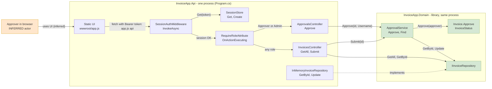
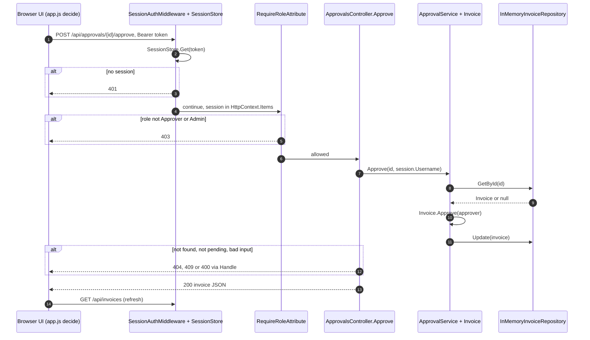
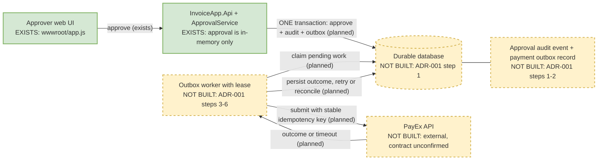

# Architecture: As-Built and Target

Paths are relative to `backend/src/` unless noted. The as-built diagrams are a static read of the code, not a runtime trace. All three diagrams were rendered from their Mermaid source using the available draw.io MCP Mermaid renderer (`io-draw-mcp-create_diagram`). A separate Mermaid MCP server was not available in this workspace, so this documents the actual tool used rather than claiming a different MCP.

## 1. As-built container view



### Citations (one per element)

| Element | Evidence |
| --- | --- |
| InvoiceApp.Api process | `InvoiceApp.Api/Program.cs` (`WebApplication.CreateBuilder`, `app.Run`) |
| Static UI | `Program.cs` `UseDefaultFiles` / `UseStaticFiles`; `InvoiceApp.Api/wwwroot/app.js` |
| SessionAuthMiddleware | `Auth/SessionAuthMiddleware.cs` `InvokeAsync`; wired by `Program.cs` `UseMiddleware` |
| SessionStore | `Auth/SessionStore.cs` `Create`, `Get`; `Program.cs` `AddSingleton<SessionStore>` |
| RequireRoleAttribute | `Auth/RequireRoleAttribute.cs` `OnActionExecuting` (403 on mismatch) |
| ApprovalsController | `Controllers/ApprovalsController.cs`, class-level `[RequireRole("Approver", "Admin")]`, `Approve` |
| InvoicesController | `Controllers/InvoicesController.cs` `GetAll`, `GetById`, `Submit`; no class-level role |
| InMemoryInvoiceRepository | `InMemoryInvoiceRepository.cs` (lock-protected `List<Invoice>`); `Program.cs` `AddSingleton<IInvoiceRepository, ...>` |
| Domain library, same process | `InvoiceApp.Api.csproj` `ProjectReference` to `InvoiceApp.Domain.csproj` |
| ApprovalService | `InvoiceApp.Domain/ApprovalService.cs` `Approve`, `Find`; `Program.cs` `AddScoped<ApprovalService>` |
| Invoice, InvoiceStatus | `InvoiceApp.Domain/Invoice.cs` `Approve`, `EnsurePending`; `InvoiceStatus.cs` |
| IInvoiceRepository | `InvoiceApp.Domain/IInvoiceRepository.cs` |
| Bearer token edge | `wwwroot/app.js` `api()` sets `Authorization: Bearer <token>`; middleware reads the same prefix |

## 2. As-built approval sequence



| Step | Evidence |
| --- | --- |
| 1 | `wwwroot/app.js` `decide` -> `api`; route from `ApprovalsController` `[HttpPost("{invoiceId}/approve")]` |
| 2-3 | `SessionAuthMiddleware.InvokeAsync` returns 401 when `SessionStore.Get` is null |
| 4-6 | `RequireRoleAttribute.OnActionExecuting` sets a 403 result; it is an MVC action filter, not middleware |
| 7 | `ApprovalsController.Approve` passes `HttpContext.GetSession().Username` |
| 8-9 | `ApprovalService.Find` (`GetById`, `KeyNotFoundException` if null) |
| 10 | `Invoice.Approve` -> `EnsurePending` (throws `InvalidOperationException` unless PendingApproval) |
| 11 | `ApprovalService.Approve` -> `Update` |
| 12-13 | `ApiControllerBase.Handle` maps `KeyNotFoundException` 404, `InvalidOperationException` 409, `ArgumentException` 400; else 200 |
| 14 | `app.js` `refresh` -> `GET /api/invoices` -> `InvoicesController.GetAll` (reads the repository directly, not via the service) |

## 3. Inferred, not verified in code

- The human approver and the browser are actors inferred from `wwwroot/app.js` and `index.html`. Nothing in the code defines them.
- The diagrams are inferred from call sites and route attributes. No runtime trace exists.
- The order MVC runs the `RequireRole` filter relative to routing is framework behavior I assumed, not something shown in this repo.
- Everything in section 4 is a plan: [ADR-001](../adr/ADR-001-exactly-once-payex-submission.md) is "accepted as the proposed target-state design" and says the demo does not integrate with PayEx.

## 4. Corrections made

| Earlier claim | Correction |
| --- | --- |
| The approval path used a Domain-to-repository edge to the concrete class. | `ApprovalService` depends only on `IInvoiceRepository`; `InMemoryInvoiceRepository` implements it (`Program.cs` registration). Container view now shows the interface. |
| Role check is part of the auth middleware edge. | The role check is `RequireRoleAttribute`, an MVC action filter. Middleware only validates the session (401). Now separate. |
| The sequence showed only the success path. | Added 401, 403 and the 404/409/400 mapping from `ApiControllerBase.Handle`. |
| Labels had unquoted parentheses and a masked `Authorization` value inside edge text. | Labels are quoted and the header is written as `Bearer token`. All diagrams render. |
| Auth might be `X-Session-Id` or JWT. | It is `Authorization: Bearer <opaque random hex token>` stored in memory (`SessionStore.Create`). No JWT. |
| A database, queue, Azure product or retry loop is part of the approval path. | None exist. `InMemoryInvoiceRepository` is a locked list; approval is synchronous. |
| Domain is a separate service. | It is a project reference loaded into the Api process. |

## 5. Target state: durable approval and PayEx submission

Green solid = exists today. Amber dashed = **NOT BUILT**. Source of the plan: [ADR-001](../adr/ADR-001-exactly-once-payex-submission.md) (transactional outbox, worker submits directly to PayEx, no broker).



No database product, schema, hosting model or broker is chosen: the ADR only mentioned Azure SQL and Service Bus in a cost estimate it has since withdrawn. PayEx must confirm durable idempotency before this can claim exactly-once payment effects.

## 6. Structural rule, enforced by a test

Rule: **`InvoiceApp.Domain` has no dependencies on the Api, ASP.NET Core, EF Core, or any package.** Two tests in [ArchitectureTests.cs](../../backend/tests/InvoiceApp.Tests/ArchitectureTests.cs) enforce it:

- `Domain_Should_Not_Depend_On_External_Layers` inspects referenced assemblies in the compiled Domain DLL. The compiler drops unused references, so on its own it can pass vacuously.
- `Domain_Project_Declares_No_Dependencies` reads `InvoiceApp.Domain.csproj` and fails on any `ProjectReference`, `PackageReference` or `FrameworkReference`. Verified by adding a temporary `PackageReference`: the test failed with `InvoiceApp.Domain must stay dependency-free but declares: Newtonsoft.Json`, then passed after reverting.

Run from the repository root (needs the .NET 8 SDK):

```powershell
dotnet test backend/tests/InvoiceApp.Tests/InvoiceApp.Tests.csproj --filter FullyQualifiedName~ArchitectureTests
```

Whole suite: `dotnet test backend/InvoiceApp.sln`.
